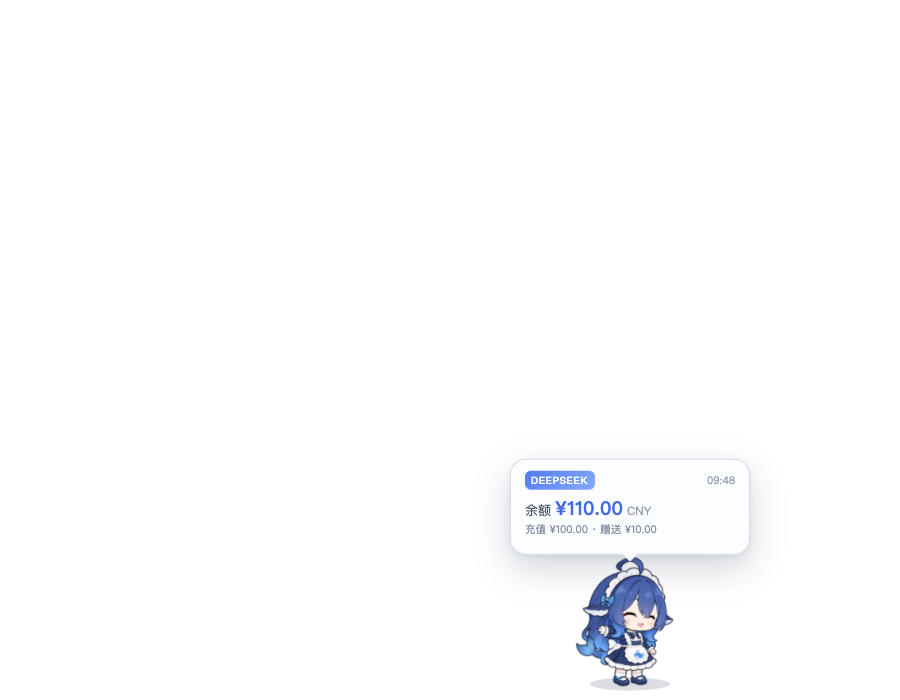

# Coo 桌面宠物

一只住在桌面上的 Coopanion 鲸鱼娘，顺手显示 AI 账户余额：点一下她、或者从菜单栏看余额，就能知道还剩多少。

- **macOS 版（`mac/`）**：Swift + AppKit + WKWebView，状态栏常驻。支持 Qoder 积分、DeepSeek、Kimi 三种数据源，可填 API Key、随时切换，可开启/关闭每 5 分钟自动刷新。
- **Windows 版（`windows/`）**：Electron 22 移植，透明置顶、托盘菜单，支持 DeepSeek 余额与本地加密保存 Key。



## 功能

- 透明、置顶、可拖拽的桌宠；只有鲸鱼本体接收鼠标，其余区域点击穿透。
- 气泡显示余额：Qoder 剩余/总积分、已用、重置时间；DeepSeek / Kimi 余额与充值、赠送明细。
- 状态栏/托盘显示当前余额，可切换数据源、配色、服装、大小。
- 「设置 API Key…」可视化填写、测试、清除 Key；Key 只保存在本机，界面只显示掩码。
- 自动刷新开关：关闭后不在启动或定时器里调用接口，只在点击桌宠或手动刷新时查询，节省 API 调用。

## 构建

### macOS

需要 macOS 12+ 和 Xcode Command Line Tools。

```sh
cd mac
./build.sh            # 生成 mac/QoderCoo.app
./build.sh --install  # 同时安装到 /Applications
```

应用未签名；首次打开如被 Gatekeeper 拦截，右键 →「打开」。

### Windows

需要 Node.js（Electron 22 支持 Node 14+）。

```sh
cd windows
npm ci
npm start
npm run pack:win   # 生成 dist/Coo-Windows-x64.zip
```

`pack:win` 会下载 Windows 版 Electron，在 macOS 上同样可以交叉打包（本仓库的 zip 就是这样构建的）。

## 数据源与隐私

- macOS 的 Qoder 积分复用本机 Qoder 客户端的登录凭证，属于非官方接口，可能随客户端升级失效；DeepSeek / Kimi 需要自己的 API Key。
- macOS Key 存放在 `~/.qoder-coo/keys.json`（权限 0600）；Windows Key 存放在 Electron userData 的 `config.json`，优先使用系统 `safeStorage`（DPAPI）加密。
- 自动刷新关闭时，启动和定时器都不会请求接口。
- 仓库不包含任何 API Key；`keys.json`、`config.json`、`node_modules/`、`dist/` 等均被忽略。

## 第三方素材

Coopanion 鲸鱼 rig 与角色素材来自 <https://github.com/Pal-AI-Lab/Coopanion>，按 AGPL-3.0-or-later 使用，并附带第 7 条 Steamworks 附加许可。详见各目录下的 `LICENSE-Coopanion.txt` 与 `THIRD-PARTY-NOTICE.md`。